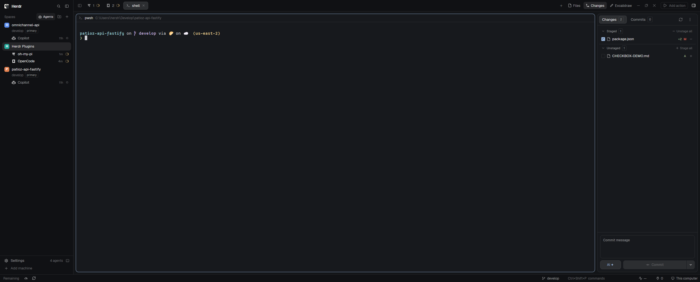
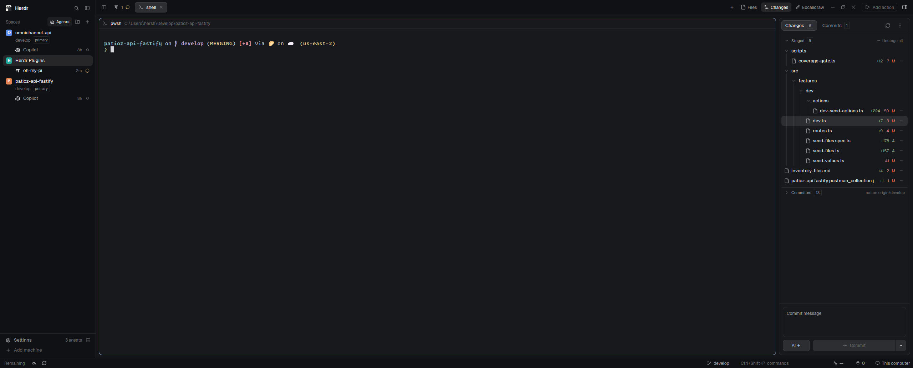

# Orca for Herdr (personal fork)

A Herdr Desktop layout after the Orca app: projects with nested worktrees and their issue/PR
badges, each one's agents and sub-agents right under it, spaces you can put to sleep (and agents
resumed after a restart), a resource meter, a hover card per worktree, in-app GitHub issues and pull requests, a Create worktree dialog
(from a branch, an issue, a PR or a new name), Files and Git changes panels, run actions, usage
limits and live ports.

**Personal fork of [VladTemp27/herdr-orca](https://github.com/VladTemp27/herdr-orca).** Differences
from upstream (`personal` branch):

- **AI commit button** — `better-changes` (vendored whole from munza/herdr-mods) gains an
  **AI ✦** button beside Commit: drafts the commit message from the uncommitted changes with a
  coding-agent CLI (opencode, claude, copilot, codex, gemini) or a direct API (deepseek,
  opencode-go, `api_key` in `mods/better-changes/config.json`, gitignored). It only fills the
  field; you review and press Commit. Also on `ctrl-shift-i` (`better-changes.ai`). Ported from
  [hershey1990/herdr-git-changes-ai](https://github.com/hershey1990/herdr-git-changes-ai)
  (MIT), which stays the standalone panel for any layout.
- **Commit checkboxes and push options** — every changed file gets a checkbox
  (screenshot above): checked = the file takes part in the next commit (it is
  what staged means here); toggling stages or unstages that one file,
  Zed-style. The commit button's ▾ menu adds **Commit & Push** (a failed push
  keeps the commit and says so) and **Push**.
- **Open in Zed** — the + menu ([screenshot](docs/screenshot-zed-menu.png))
  gains an **Open in Zed** row when Zed is installed (probed once every 5
  minutes). Local folders only; the launcher finds the real relay
  `bin\Zed.exe` (the `zed` on PATH is a bash shim) and starts it without
  waiting, so a cold first launch never blocks the window.
- **Branch switcher** — every repo space's right-click menu gains
  **Switch branch…**: lists branches with tip and upstream, current marked,
  branches held by another worktree dimmed, type-to-filter, and git's own
  error when it refuses. `mods/branch-picker/`.
- **New space from folder** — in the + menu and beside the Spaces header's
  `+`: pick a folder in the system dialog and the space's terminal starts
  right there.
- **Files panel, faster and steadier** — one PowerShell process lists root
  plus every expanded folder (was one per folder); the tree anchors on the
  space's repository so a focused pane outside the project cannot re-root
  it; git-ignored entries are actually dimmed (a `/` vs `\` mismatch had
  silenced that on Windows); junctions/symlinked folders expand; a refresh
  button and per-folder watches cover missed updates; and switching spaces
  paints the tree instantly from a per-space cache (stale-while-revalidate,
  LRU of 8).
- **File viewer edit mode** — ✎ Edit turns the read-only viewer into a basic
  editor (● modified, Save or ctrl+s, atomic write that refuses to clobber a
  file changed on disk), with **Open in editor…** beside it for the real IDE.
- **Resume agents after a reboot** — Hibernate learned copilot, omp/pi and
  opencode: sessions are resolved per tool and cached per process, so an
  automatic resume continues the conversation instead of relaunching a bare
  command. `after_restart: "auto"` in Hibernate's settings.
- **Sidebar nav removed** — no Automations / Issues / Mod settings column; mods `automations`,
  `sidebar-nav` deleted, `better-config` not vendored. The footer's Settings button opens
  Herdr's own settings.
- `sync.sh` reads `layouts/orca.json` (upstream hardcodes the author's `orca-2`).

See [RECIPE.md](RECIPE.md) for what it does and how it's built, and
[THIRD_PARTY.md](THIRD_PARTY.md) for credits and licenses. The issues, live ports, usage limits and
actions mods are also published on their own in
[VladTemp27/herdr-mods](https://github.com/VladTemp27/herdr-mods).

## Install

Ask your Herdr agent:

> Read ~/.config/herdr-app/AGENTS.md, then add this layout: https://github.com/hershey1990/herdr-orca

Everything is vendored — no separate mods to install. `better-changes` comes from
[munza/herdr-mods](https://github.com/munza/herdr-mods) (Apache-2.0, see THIRD_PARTY.md) with the
AI commit button added on top.

By hand:

1. Copy `layouts/orca.json` into `~/.config/herdr-app/layouts/` and each folder in `mods/` into
   `~/.config/herdr-app/mods/`. Rename anything whose name you already use.
2. Merge `keys.json` into `~/.config/herdr-app/keys.json` (its `layout:orca` section applies only
   while this layout shows).
3. Run `herdr-app check ~/.config/herdr-app/mods/<name>` for each mod, then
   `herdr-app do layout.switch '{"name":"orca"}'`. `ctrl-shift-l` switches back.

Needs `git` and a logged-in `gh`. Usage limits read the `claude` and `codex` CLIs; desktop
notifications use `terminal-notifier` when installed (macOS).

**Platform notes.** Upstream was built on macOS; this fork is developed and used daily on
**Windows 11 ARM64 with Herdr 0.1.17**, where every feature above was tested (0.1.16 before it; the layout and all vendored mods re-checked clean on each). The key bindings
come in both spellings (`cmd-*` for macOS, `ctrl-*` for Windows/Linux). A few mod behaviors
were fixed for Windows along the way (forward/backslash path normalization for git-ignored
dimming, junction/symlinked directories expand, a child-process folder picker where the
native `pickFolder` dialog hangs on some setups). macOS should keep working; `terminal-notifier`
and the resource meter's `sysctl` call remain macOS-flavored and degrade gracefully elsewhere.

## Updating this repo

`./sync.sh` copies the layout and these mods from your Herdr home into the repo.
`previews/render.sh` redraws `preview.png` from `previews/preview.html` with headless Chrome:
the preview is an HTML mockup with demo data, so no screenshot of your own work is published.

## License

Apache-2.0, see [LICENSE](LICENSE) and [NOTICE](NOTICE).
